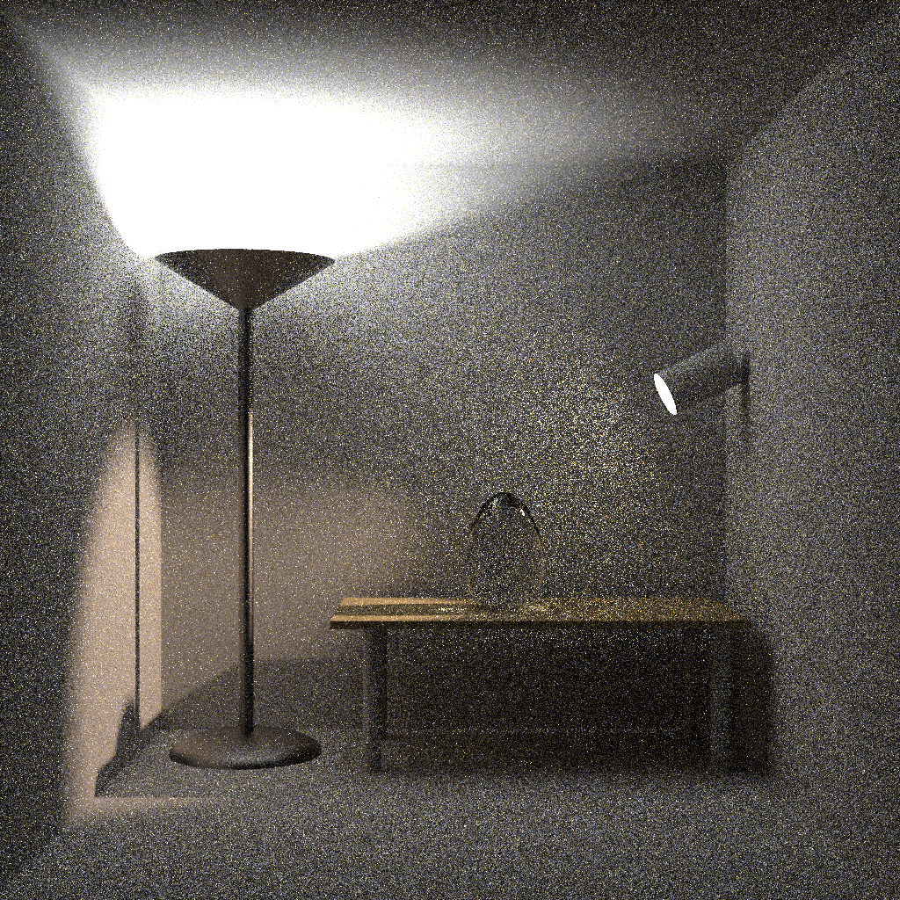
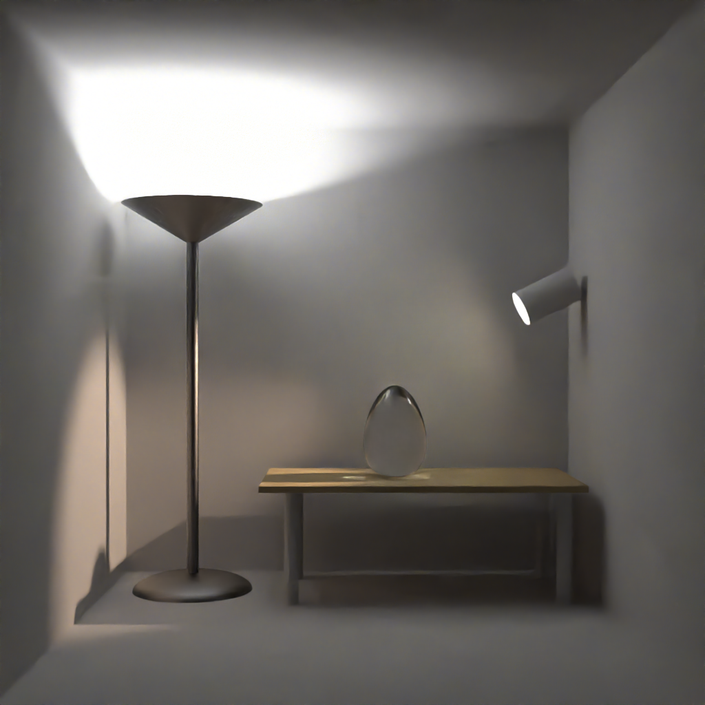

# PyOIDN: Intel Open Image Denoise Python binding

[](https://github.com/Hyiker/pyoidn/tags) [](https://github.com/Hyiker/pyoidn/actions/workflows/testing.yml) [](https://github.com/Hyiker/pyoidn/actions/workflows/docs.yml)

Yet another unofficial Intel [Open Image Denoise (OIDN)](https://www.openimagedenoise.org/) Python binding -- but more Pythonic. Checkout [docs](https://pyoidn.carbene.cc/) for more details.

## Features

- Directly use NumPy arrays as input/output images.
- Support all OIDN filter types.
- Simple and clean API design.
- Lightweight: only depends on NumPy and the OIDN shared library.
- CUDA device support (via PyTorch).

## Install

To install the latest release from PyPI:

```bash
pip install pyoidn
```

The default installation only includes lightweight CPU support with [NumPy](https://numpy.org/). Additionally, pyoidn provides support via [PyTorch](https://pytorch.org/) which enables CUDA device support:

```bash
pip install pyoidn[torch]
```

Note: this variant doesn't support Intel Macs, use the default installation instead.

## Quickstart

Given a noisy image, plus its normal map and albedo map, denoise and save the result.



```python
import numpy as np
from PIL import Image
import pyoidn


def load_image(path: str) -> np.ndarray:
    return np.array(Image.open(path), dtype=np.float32) / 255.0


color = load_image(color_path)
normal = load_image(normal_path)
albedo = load_image(albedo_path)
result = pyoidn.denoise(color, albedo=albedo, normal=normal)

result_u8 = np.array(np.clip(result * 255, 0, 255), dtype=np.uint8)
Image.fromarray(result_u8).save(output_path)
```

Only `color` is required. The convenience API accepts RGB images of shape
`(height, width, 3)` with float32 or float16 dtype, handles noncontiguous inputs,
and returns a new image without modifying the inputs. Use `hdr=True` for linear
HDR colors, `quality="fast"` for previews, or `filter_type="RTLightmap"` for HDR
lightmaps without auxiliary images.

Native devices and filters are initialized lazily and reused across calls until
process exit. Each result remains independent of later calls. Calls complete
before returning, are serialized for safe reuse, and raise `RuntimeError` if OIDN
reports a failure. The [low-level API](#low-level-api) provides explicit resource
management and asynchronous execution.

The result:



If you have installed the PyTorch support, you can also use CUDA devices:

```python
import torch

torch_device = torch.device("cuda:0")
color_t = torch.from_numpy(color).to(device=torch_device, dtype=torch.float32).contiguous()
normal_t = torch.from_numpy(normal).to(device=torch_device, dtype=torch.float32).contiguous()
albedo_t = torch.from_numpy(albedo).to(device=torch_device, dtype=torch.float32).contiguous()
result_t = pyoidn.denoise(color_t, albedo=albedo_t, normal=normal_t)
```

Torch results preserve the input dtype and device and do not require gradients.
CPU tensors share the NumPy CPU device; CUDA resources are reused per GPU and
current Torch stream.

## Low-level API

Use `Device` and `Filter` directly to control device settings, image bindings,
filter parameters, and resource lifetime. This complete example loads three RGB
images, denoises them on the CPU, and saves the result. Replace the filenames with
your own images; the normal map is assumed to be encoded in [0, 1] on disk.

```python
import numpy as np
from PIL import Image
import pyoidn


def load_image(path: str) -> np.ndarray:
    return np.array(Image.open(path).convert("RGB"), dtype=np.float32) / 255.0


def check_error(device: pyoidn.Device) -> None:
    message = device.get_error()
    if message is not None:
        raise RuntimeError(message)


# Contiguous HxWx3 float32 images; normals must be in [-1, 1].
color = load_image("color.png")
albedo = load_image("albedo.png")
normal = load_image("normal.png") * 2.0 - 1.0
result = np.empty_like(color)

with pyoidn.Device(pyoidn.OIDN_DEVICE_TYPE_CPU) as device:
    check_error(device)
    device.set_int("numThreads", 0)  # Let OIDN choose the CPU thread count.
    device.commit()
    check_error(device)

    flt = pyoidn.Filter(device, pyoidn.OIDN_FILTER_TYPE_RT)
    try:
        check_error(device)
        flt.set_image(pyoidn.OIDN_IMAGE_COLOR, color, pyoidn.OIDN_FORMAT_FLOAT3)
        flt.set_image(pyoidn.OIDN_IMAGE_ALBEDO, albedo, pyoidn.OIDN_FORMAT_FLOAT3)
        flt.set_image(pyoidn.OIDN_IMAGE_NORMAL, normal, pyoidn.OIDN_FORMAT_FLOAT3)
        flt.set_image(pyoidn.OIDN_IMAGE_OUTPUT, result, pyoidn.OIDN_FORMAT_FLOAT3)
        flt.set_bool("hdr", False)  # Use True for linear HDR input.
        flt.set_bool("cleanAux", False)  # Use True only for noise-free auxiliary images.
        flt.set_quality(pyoidn.OIDN_QUALITY_HIGH)
        flt.commit()
        check_error(device)

        flt.execute()
        check_error(device)
    finally:
        flt.release()

result_u8 = np.clip(result * 255.0, 0, 255).astype(np.uint8)
Image.fromarray(result_u8).save("denoised.png")
```

Albedo and normal bindings are optional. Keep image arrays alive while they are
bound to the filter, and use contiguous storage with a dtype matching the OIDN
format. The device context manager releases the device; `try/finally` releases the
filter first, including when configuration or execution fails.

For repeated images, keep the device and filter alive and call `execute()` again.
Updating pixel values in an already-bound array does not require another commit.
After changing image bindings or filter parameters, call `flt.commit()` again
before execution.

### Asynchronous execution

Inside the example's `try` block, replace `flt.execute()` and its error check with:

```python
flt.execute_async()
check_error(device)
# Do independent host work here while denoising runs.
device.wait()
check_error(device)
```

Wait before reading `result`, changing its input images, or releasing the filter
and device. The low-level API reports OIDN errors through `device.get_error()`;
the `check_error()` helper above turns those messages into Python exceptions.

For explicit CUDA control, create the device with
`pyoidn.Device.from_torch(color_t.device)` after checking
`pyoidn.Device.is_cuda_available(color_t.device.index)`. Bind contiguous Torch
input and output tensors through the same `flt.set_image()` calls; they must be
on that CUDA device. The OIDN device uses the current Torch CUDA stream.

## Notes

- Low-level error handling: use `device.get_error()` after creating/committing/executing.
- Async examples: see `tests/test_filter.py`.

## Documentation

Build locally:

```bash
pip install -r requirements-docs.txt
mkdocs serve
```

## Roadmap

- [x] CPU device support
- [x] NumPy array support
- [x] All filter types support
- [x] OIDN buffer support
- [x] RAII-style resource management
- [ ] More device types
  - [x] CUDA (torch)
  - [ ] SYCL
  - [ ] Metal
- [x] Documents
- [ ] Examples

## License

This project is licensed under the MIT License. See [LICENSE](LICENSE).

This project includes:

- [Intel Open Image Denoise](https://github.com/RenderKit/oidn) (Apache License 2.0)
